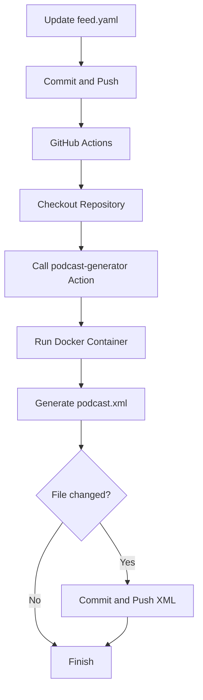

# 🎙️ Podcast Test — Automated RSS Feed Generator

A practical **GitHub Actions and CI/CD automation project** that generates Podcast RSS feeds from YAML configuration files using a reusable Docker Container Action.

## 1. Project Overview

This repository demonstrates how to automate podcast RSS feed generation using GitHub Actions.

Podcast metadata and episode information are stored in `feed.yaml`. A GitHub Actions workflow invokes a reusable Docker Container Action hosted in a separate repository to generate `podcast.xml`.

### Key Features

- YAML-based podcast configuration
- Automated RSS 2.0 XML generation
- Reusable Docker Container Action
- GitHub Actions workflow automation
- Automatic Git commit and push when the RSS file changes
- Git version history and rollback support
- Separation of application data and generator logic

## 2. System Architecture

The solution consists of two repositories.

### Provider — Podcast Generator

**Repository:** [KukeitChanahan/podcast-generator](https://github.com/KukeitChanahan/podcast-generator)

Contains the reusable Docker Container Action:

- `Dockerfile` — Defines the container environment
- `action.yml` — Defines Action metadata and inputs
- `entrypoint.sh` — Executes the generator and Git operations
- `feed.py` — Converts YAML data into XML

### Consumer — Podcast Test

**Repository:** [KukeitChanahan/podcast-test](https://github.com/KukeitChanahan/podcast-test)

Contains podcast configuration, media, generated XML, and the GitHub Actions workflow that invokes the provider.

### Automation Flow



## 3. Repository Structure

```text
podcast-test/
├── .github/
│   └── workflows/
│       └── main.yml
│
├── audio/
│   └── Podcast audio files
│
├── images/
│   └── Podcast artwork
│
├── README.md
├── feed.yaml
└── podcast.xml
```

| File / Directory | Description |
|---|---|
| `.github/workflows/main.yml` | GitHub Actions workflow |
| `audio/` | Podcast audio files |
| `images/` | Podcast artwork |
| `feed.yaml` | Podcast metadata and episodes |
| `podcast.xml` | Generated RSS feed |
| `README.md` | Project documentation |

The Python generator is maintained separately in the `podcast-generator` repository.

## 4. Technology Stack

| Technology | Purpose |
|---|---|
| GitHub Actions | Workflow automation |
| Docker | Container runtime |
| Python | RSS feed generation |
| PyYAML | YAML parsing |
| Git | Version control |
| GitHub Codespaces | Cloud development environment |
| GitHub Pages | Optional static hosting |

## 5. Podcast Configuration

Podcast information is maintained in `feed.yaml`.

The configuration contains channel metadata and episode details.

Example:

```yaml
title: The Future in Tech
subtitle: Powered by LinkedIn Learning
author: Ray Villalobos
description: Conversations about emerging technologies.
image: /images/artwork.jpg
language: en-us
category: Technology
format: audio/mpeg
link: https://kukeitchanahan.github.io/podcast-test

item:
  - title: "EP01 - What's Happening in 2023"
    description: A discussion about emerging technology.
    published: Thu, 12 Jan 2023 18:00:00 GMT
    file: /audio/TFIT01.mp3
    duration: "00:00:36"
    length: "576324"
```

The `item` field contains a list of podcast episodes.

**Important:** Audio file lengths must represent file sizes in bytes without thousands separators. Verify that all media URLs point to accessible files.

## 6. GitHub Actions Workflow

Workflow location:

`.github/workflows/main.yml`

```yaml
name: Generate Podcast Feeds

on:
  push:
    branches: [main]

permissions:
  contents: write

jobs:
  build:
    runs-on: ubuntu-latest

    steps:
      - name: Checkout Repo
        uses: actions/checkout@v4

      - name: Run Feed Generator
        uses: KukeitChanahan/podcast-generator@main
        with:
          name: "KukeitChanahan"
          email: "kukeit.ch@gmail.com"
```

### How It Works

1. A developer updates `feed.yaml`.
2. Changes are committed and merged into `main`.
3. GitHub Actions starts the workflow.
4. The workflow checks out the repository.
5. The reusable Docker Action is executed.
6. The Action reads `feed.yaml`.
7. Python generates `podcast.xml`.
8. If the XML changes, the Action commits and pushes the updated file.

The workflow uses `contents: write` to allow repository updates, subject to branch protection and repository policies.

For production use, a pinned Action release tag or full commit SHA is preferable to `@main`.

## 7. Development Workflow

### Create a Feature Branch

```bash
git switch main
git pull --ff-only origin main

git switch -c feature/update-podcast
```

### Modify Podcast Configuration

Edit `feed.yaml` to update podcast details or add episodes.

### Commit Changes

```bash
git add feed.yaml

git commit -m "Update podcast metadata"
```

### Push the Feature Branch

```bash
git push -u origin feature/update-podcast
```

### Create a Pull Request

Navigate to GitHub and create a Pull Request with:

- Base: `main`
- Compare: `feature/update-podcast`

Review and merge the changes.

### Automatic Generation

After the merge updates `main`, GitHub Actions invokes the reusable generator.

There is no need to run `feed.py` directly in this repository.

## 8. Monitoring GitHub Actions

Navigate to:

**Repository → Actions → Generate Podcast Feeds**

Open the latest workflow run.

Check the following:

- Checkout Repo completed successfully.
- Docker Action execution succeeded.
- XML generation completed.
- `podcast.xml` was updated when necessary.
- No empty commit was created when the output was unchanged.

**Note:** A successful GitHub Actions run does not necessarily mean the latest RSS feed has been published to GitHub Pages.

## 9. RSS Output

The generated file is stored at:

`podcast.xml`

View the file in GitHub:

[View Podcast RSS XML](https://github.com/KukeitChanahan/podcast-test/blob/main/podcast.xml)

Expected GitHub Pages URL, if publishing is correctly configured:

https://kukeitchanahan.github.io/podcast-test/podcast.xml

GitHub Pages deployment is separate from RSS generation.

In particular, a commit pushed using the default `GITHUB_TOKEN` does not automatically trigger another push-based workflow or branch-based Pages build.

## 10. Troubleshooting

| Issue | Possible Cause | Resolution |
|---|---|---|
| Workflow does not run | Incorrect trigger or branch | Check `main.yml` |
| Custom Action not found | Incorrect repository or ref | Verify `uses:` |
| YAML parsing error | Invalid YAML syntax | Validate `feed.yaml` |
| Missing YAML field | Configuration does not match generator expectations | Review the required fields |
| XML generation failed | Python generator error | Review Docker Action logs |
| Git push rejected | Insufficient permissions or branch rules | Check repository settings |
| No new commit | Generated XML is unchanged | No action required |
| RSS website not updated | Pages deployment not triggered | Check deployment configuration |

## 11. Rollback Procedure

If a change breaks the RSS feed:

1. Identify the problematic commit or Pull Request.
2. Create a revert Pull Request.
3. Review the reverted changes.
4. Merge the revert into `main`.
5. Allow GitHub Actions to regenerate the feed.
6. Verify `podcast.xml` and the publishing destination.

If the generator itself introduces the problem, restore a previously tested version of `podcast-generator`.

Avoid force-pushing to shared branches.

## 12. Security and Best Practices

- Use least-privilege GitHub Actions permissions.
- Avoid committing credentials, tokens, or secrets.
- Review changes through Pull Requests.
- Validate YAML before publishing RSS.
- Use stable Action versions for production.
- Avoid force-pushing to `main`.
- Separate automated commits from human commits where auditability is important.
- Review GitHub Actions logs when a workflow fails.

## 13. Future Improvements

Planned enhancements include:

- Automated YAML validation
- RSS format validation
- Unit tests for the generator
- Better error handling
- Stable Action release versions
- Automated GitHub Pages deployment
- Integration testing
- Improved logging and monitoring

## 14. Credits and Attribution

This repository uses sample content associated with **The Future in Tech**, hosted by Ray Villalobos and powered by LinkedIn Learning.

Original series:

https://go.raybo.org/tfit

This is an independent technical learning project.

The original podcast content, artwork, descriptions, and audio remain the intellectual property of their respective rights holders. Public redistribution requires appropriate authorization.

## 15. References

- [GitHub Actions Documentation](https://docs.github.com/en/actions)
- [GitHub Codespaces Documentation](https://docs.github.com/en/codespaces)
- [Creating a Docker Container Action](https://docs.github.com/en/actions/tutorials/create-actions/create-a-docker-container-action)
- [Docker Documentation](https://docs.docker.com/)
- [Podcast Generator Repository](https://github.com/KukeitChanahan/podcast-generator)

---

## Maintainer

**KukeitChanahan**

GitHub: https://github.com/KukeitChanahan

**Repository:** https://github.com/KukeitChanahan/podcast-test

*Practical DevOps learning project using GitHub Actions, Docker, Python, YAML, and reusable automation.*
