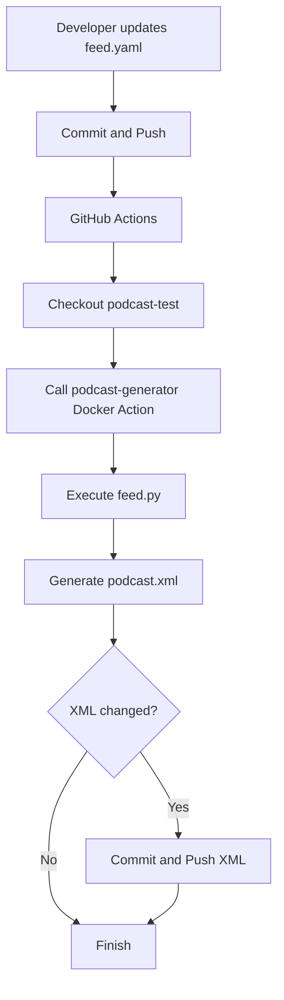

# 🎙️ Podcast Test — Automated RSS Feed with GitHub Actions

A practical DevOps project that generates and maintains a Podcast RSS 2.0 feed using **Python, YAML, GitHub Actions, and a reusable Docker Container Action**.

This repository demonstrates how podcast metadata can be converted into XML and automatically updated through a GitHub Actions workflow.

## 1. Project Overview

**Podcast Test** is a learning project focused on workflow automation, CI/CD concepts, data transformation, and reusable GitHub Actions.

The repository uses podcast metadata from *The Future in Tech* as sample content to demonstrate RSS feed generation.

### Key Features

- Store podcast metadata in YAML.
- Generate RSS 2.0 XML using Python.
- Support podcast episodes, descriptions, artwork, and audio enclosures.
- Trigger automation when changes are pushed to the `main` branch.
- Execute a reusable Docker Container Action.
- Commit and push updated RSS output automatically when its content changes.
- Maintain version history using Git.

## 2. Technology Stack

| Technology | Purpose |
|---|---|
| Python | Podcast RSS generation |
| PyYAML | YAML parsing |
| XML ElementTree | XML generation |
| GitHub Actions | Workflow automation |
| Docker | Container runtime for the reusable action |
| Git | Source control and version history |
| GitHub Codespaces | Cloud-based development environment |
| GitHub Pages | Optional static hosting for RSS files |

## 3. Repository Structure

```text
podcast-test/
├── .github/
│   └── workflows/
│       └── main.yml
├── audio/
├── images/
├── feed.py
├── feed.yaml
├── podcast.xml
└── README.md
```

### File Descriptions

**feed.yaml**

Contains podcast configuration, metadata, and episode information.

**feed.py**

Reads YAML data and converts it into an RSS 2.0 XML document.

**podcast.xml**

Contains the generated RSS feed.

**.github/workflows/main.yml**

Defines the GitHub Actions workflow and invokes the reusable Podcast Generator Action.

**audio/**

Contains sample podcast audio files.

**images/**

Contains podcast artwork.

## 4. System Architecture



The solution separates two responsibilities.

### Consumer Repository — podcast-test

Stores podcast metadata, media files, generated RSS output, and the workflow that invokes the generator.

### Provider Repository — podcast-generator

Contains the reusable GitHub Docker Container Action.

Repository:

https://github.com/KukeitChanahan/podcast-generator

The provider includes:

- `action.yml` — GitHub Action metadata
- `Dockerfile` — Container environment
- `entrypoint.sh` — Execution and Git automation
- `feed.py` — Podcast feed generation logic

This architecture demonstrates **separation of concerns and reusable automation**.

## 5. Podcast Configuration

Podcast information is maintained in `feed.yaml`.

The current schema uses a singular `item` key containing a list of episodes.

Example:

```yaml
title: The Future in Tech
subtitle: Powered by LinkedIn Learning
author: Ray Villalobos
description: Conversations about emerging technology.
image: /images/artwork.jpg
language: en-us
category: Technology
format: audio/mpeg
link: https://kukeitchanahan.github.io/podcast-test

item:
  - title: "EP01 - What's Happening in 2023"
    description: A discussion about emerging technologies.
    published: Thu, 12 Jan 2023 18:00:00 GMT
    file: /audio/TFIT01.mp3
    duration: "00:00:36"
    length: "576324"
```

### Podcast Fields

| Field | Description |
|---|---|
| `title` | Podcast title |
| `subtitle` | Podcast subtitle |
| `author` | Podcast creator or author |
| `description` | Podcast description |
| `image` | Podcast artwork path |
| `language` | Podcast language |
| `category` | Podcast category |
| `format` | Audio format |
| `link` | Base URL |
| `item` | List of podcast episodes |

Each episode contains its title, description, publication date, audio file path, duration, and file size.

**Important:** Audio enclosure lengths must be expressed as numeric byte counts without thousands separators.

## 6. GitHub Actions Workflow

The GitHub Actions workflow is defined in:

`.github/workflows/main.yml`

```yaml
name: Generate Podcast Feeds

on:
  push:
    branches: [main]

permissions:
  contents: write

jobs:
  build:
    runs-on: ubuntu-latest

    steps:
      - name: Checkout Repo
        uses: actions/checkout@v4

      - name: Run Feed Generator
        uses: KukeitChanahan/podcast-generator@main
        with:
          name: "KukeitChanahan"
          email: "kukeit.ch@gmail.com"
```

### How the Workflow Works

1. A developer pushes or merges changes into `main`.
2. GitHub Actions starts an Ubuntu runner.
3. The workflow checks out the repository.
4. It invokes the reusable `podcast-generator` Docker Action.
5. The Docker Action runs the Python feed generator.
6. The generator reads `feed.yaml` and creates `podcast.xml`.
7. If XML content changes, the Action commits and pushes the updated file.

The workflow uses `contents: write` because the Action is designed to push generated files back to the repository.

**Note:** Automated pushes remain subject to repository permissions and branch protection rules.

## 7. Running the Generator Locally

You can generate the podcast feed without GitHub Actions.

### Step 1 — Clone the Repository

```bash
git clone https://github.com/KukeitChanahan/podcast-test.git

cd podcast-test
```

### Step 2 — Install Dependencies

```bash
python -m pip install PyYAML
```

### Step 3 — Generate XML

```bash
python feed.py
```

The generator reads `feed.yaml` and writes `podcast.xml`.

### Step 4 — Validate XML Syntax

```bash
python -c "import xml.etree.ElementTree as ET; ET.parse('podcast.xml'); print('XML OK')"
```

Expected output:

```text
XML OK
```

This validates XML well-formedness, not full podcast platform compatibility.

## 8. Development Workflow

Use a feature branch for changes.

### Create a Feature Branch

```bash
git switch main
git pull --ff-only origin main
git switch -c feature/update-podcast
```

### Update the Podcast

Modify `feed.yaml`, then test locally:

```bash
python feed.py
```

### Stage and Commit

```bash
git add feed.yaml podcast.xml

git commit -m "Update podcast metadata"
```

### Push the Feature Branch

```bash
git push -u origin feature/update-podcast
```

### Create a Pull Request

Open GitHub and create a Pull Request:

- Base: `main`
- Compare: `feature/update-podcast`

Review the changes and merge the Pull Request.

Once `main` is updated, the GitHub Actions workflow runs automatically.

### Sync the Local Main Branch

```bash
git switch main
git pull --ff-only origin main
```

## 9. GitHub Actions Monitoring

Navigate to:

**Repository → Actions → Generate Podcast Feeds**

Select the latest workflow run.

Verify:

- Checkout Repo completed successfully.
- Run Feed Generator completed successfully.
- `podcast.xml` was generated.
- Updated XML was committed when its content changed.
- No unnecessary commit was created when the XML was unchanged.

A successful workflow run does not automatically guarantee that the generated feed has been deployed to GitHub Pages.

## 10. Podcast Feed and Hosting

Repository RSS source:

https://github.com/KukeitChanahan/podcast-test/blob/main/podcast.xml

Expected GitHub Pages feed URL, if Pages is correctly configured:

https://kukeitchanahan.github.io/podcast-test/podcast.xml

GitHub Pages must be configured separately.

This workflow generates and updates the XML file but does not explicitly deploy a Pages artifact.

For reliable deployment automation, the publishing workflow should ensure that the latest XML is included in the deployed output.

## 11. Troubleshooting

| Problem | Possible Cause | Solution |
|---|---|---|
| Workflow does not start | No matching push event | Verify the `main` branch trigger |
| Action not found | Incorrect provider reference | Verify the provider repository and ref |
| `feed.yaml` not found | Incorrect working directory | Check repository checkout and workspace |
| `KeyError` | YAML field missing | Verify required YAML keys |
| Invalid XML | Incorrect generated content | Validate XML and generator logic |
| Push rejected | Missing permission or protected branch | Review permissions and branch rules |
| No new commit | Generated XML is unchanged | No action required |
| Old RSS still displayed | Pages deployment not updated | Check publishing configuration |

## 12. Security and Best Practices

- Use the minimum GitHub Actions permissions required.
- Do not store API keys, passwords, or tokens in the repository.
- Review changes through Pull Requests.
- Avoid force-pushing to `main`.
- Validate YAML inputs and XML outputs.
- Keep the reusable Docker Action version-controlled.
- Prefer a released version tag or pinned commit SHA instead of `@main` for production.
- Use bot commit identities when audit separation between manual and automated changes is important.

## 13. Rollback Procedure

If a new change breaks feed generation:

1. Identify the problematic commit or Pull Request.
2. Create a revert Pull Request.
3. Review and merge the revert.
4. Verify the generator executes successfully.
5. Inspect the generated `podcast.xml`.
6. Verify the publishing destination separately.

Avoid rewriting shared branch history.

## 14. Future Improvements

Planned engineering enhancements include:

- Automated unit tests for `feed.py`
- Required-field validation for YAML
- RSS 2.0 and podcast metadata validation
- Correct audio enclosure byte-length handling
- Configurable feed output paths
- Stable versioning for the Docker Action
- Separation of feed generation from Git commit/push operations
- Automated GitHub Pages deployment
- CI test reports and release management

## 15. Credits and Content Attribution

The sample podcast metadata and episode descriptions in this repository reference **The Future in Tech**, hosted by Ray Villalobos and associated with LinkedIn Learning.

Original series:

https://go.raybo.org/tfit

This repository is an independent technical learning project and does not claim ownership of the original podcast material.

Third-party audio, artwork, descriptions, and other content remain subject to their respective owners' rights and licensing terms. The presence of media in this repository does not establish permission for redistribution.

## 16. References

- [GitHub Actions Documentation](https://docs.github.com/en/actions)
- [GitHub Codespaces Documentation](https://docs.github.com/en/codespaces)
- [Docker Documentation](https://docs.docker.com/)
- [RSS 2.0 Specification](https://www.rssboard.org/rss-specification)
- [Podcast Generator Action](https://github.com/KukeitChanahan/podcast-generator)

---

## Project Maintainer

**KukeitChanahan**

GitHub: https://github.com/KukeitChanahan

Project Repository: https://github.com/KukeitChanahan/podcast-test

*Developed as a practical learning project covering Python, Docker, GitHub Actions, version control, and CI/CD automation.*
